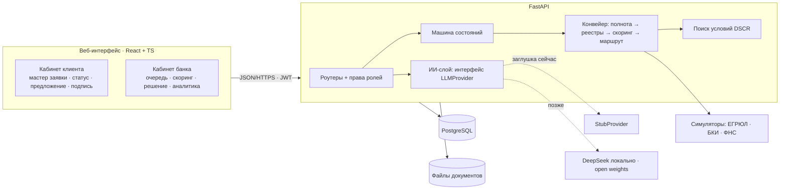

# Архитектура

## Принципы
1. **Один процесс — одна машина состояний.** Клиент и банк работают с одной заявкой; статус меняется только через `transition()`.
2. **Скоринг ≠ решение.** Скоринг оценивает риск; решение — это скоринг + стоп-факторы политики + лимиты продукта + платёжеспособность.
3. **Автоматика для простого, человек для сложного.** Маршруты: `auto_approve` / `manual` / `reject`.
4. **ИИ изолирован.** Любой вызов ИИ идёт через `app/ai/base.py`. Отказ ИИ не ломает процесс: правила работают без него.
5. **Симуляторы внешних систем** подменяются реальными адаптерами с тем же форматом ответа.

## Enterprise-ориентированность: что сделано и что нет
| Аспект | Сделано | Не сделано (следующий шаг) |
|---|---|---|
| Безопасность | PBKDF2, JWT с ролями, проверка владения заявкой на каждом запросе, валидация входа (Pydantic), белый список полей ответа, лимит и типы файлов, имена файлов не от клиента | rate limit входа, антивирус, шифрование файлов, KMS/секреты |
| Надёжность | БД как источник истины, возобновляемый конвейер, `409` при гонках, ошибка шага логируется и не роняет заявку | очередь задач (Celery/Temporal) вместо потока, ретраи |
| Отказоустойчивость | healthcheck, Postgres с томом, `restart` в Compose легко добавляется | репликация БД |
| Масштабирование | stateless API, состояние в БД | вынос конвейера в воркеры |
| Сопровождение | журнал событий, версия модели скоринга в каждой записи, OpenAPI, тесты | метрики и трассировка |
| Данные | синтетические; ИИ получает только обезличенные признаки (по плану) | маскирование ПДн в логах |
