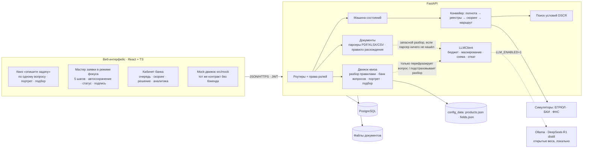

# Архитектура

## Принципы
1. **Один процесс — одна машина состояний.** Клиент и банк работают с одной заявкой; статус меняется только через `transition()`.
2. **Скоринг ≠ решение.** Скоринг оценивает риск; решение — это скоринг + стоп-факторы политики + лимиты продукта + платёжеспособность. Подбор продукта в квизе — тоже подсказка, не решение.
3. **Автоматика для простого, человек для сложного.** Маршруты: `auto_approve` / `manual` / `reject`.
4. **Правила первыми, модель точечно.** Разбор запроса, выбор вопроса, портрет, подбор, «Почему подходит», скоринг и решение — только правила и шаблоны. Модель (если включена) лишь перефразирует вопрос квиза и подстраховывает разбор текста/документа. Без модели всё работает на банке вопросов.
5. **Модель под контролем:** `LLM_ENABLED=0` по умолчанию; не больше `LLM_MAX_CALLS` (3) вызовов на сессию/заявку; таймаут `LLM_TIMEOUT` (8 с); ответ — только JSON по схеме; вопрос обязан ссылаться на поле из белого списка (реестр полей), иначе берётся банк; `<think>…</think>` вырезается; ИНН, телефоны, e-mail и ФИО маскируются до отправки; текст клиента — данные, а не инструкции; каждый вызов пишется в `ai_calls`.
6. **Симуляторы внешних систем** подменяются реальными адаптерами с тем же форматом ответа.
7. **Конфигурация, а не код:** каталог продуктов (условия допуска: ИП/ООО, возраст бизнеса, залог) и реестр полей квиза — JSON в `backend/app/config_data`; фронтенд-мок читает те же файлы (`frontend/src/config`), равенство проверяет тест.

## Как устроен квиз
`POST /api/intake/start` → правила (`app/intake/parse.py`) вытаскивают цель, сумму, срок, форму, возраст бизнеса, залог → реестр полей (`fields.json`) определяет, что пусто и влияет на подбор → вопрос берётся из банка карточками (модель — только формулировка) → при двусмысленной цели один уточняющий вопрос → портрет задачи → `POST /intake/{id}/recommend` (правила допуска + шаблоны «Почему подходит») → `POST /intake/{id}/application` создаёт черновик, дальше мастер.

## Как устроены документы
`POST /api/applications/{id}/documents` → парсер по расширению (текстовый PDF через pypdf, XLSX через openpyxl, CSV) → значения с подписью источника в `doc_extractions` → правило расхождения (оборот×12 против выручки > 35% → `conflict`) → клиент правит или подтверждает через `PATCH /api/extractions/{id}`; пока есть `conflict`, отправка заявки отвечает `422`. Скан без текста → поля остаются пустыми, а модель (если включена) делает запасную попытку.

## Enterprise-ориентированность: что сделано и что нет
| Аспект | Сделано | Не сделано (следующий шаг) |
|---|---|---|
| Безопасность | PBKDF2, JWT с ролями, проверка владения заявкой/сессией/извлечением на каждом запросе, валидация входа (Pydantic), белый список полей ответа и полей для модели, лимит и типы файлов, имена файлов не от клиента, маскирование ПДн перед моделью | rate limit входа, антивирус, шифрование файлов, KMS/секреты |
| Надёжность | БД как источник истины, возобновляемый конвейер, `409` при гонках, ошибка шага логируется и не роняет заявку, любой сбой модели → откат на банк вопросов | очередь задач (Celery/Temporal) вместо потока, ретраи |
| Отказоустойчивость | healthcheck, Postgres с томом, модель опциональна и не в критическом пути | репликация БД |
| Масштабирование | stateless API, состояние в БД, модель — отдельный контейнер | вынос конвейера в воркеры |
| Сопровождение | журнал событий, `ai_calls`, версия каталога в БД, версия модели скоринга в каждой записи, OpenAPI, тесты | метрики и трассировка |
| Данные | синтетические; в модель уходят только обезличенные признаки | маскирование ПДн в логах |
