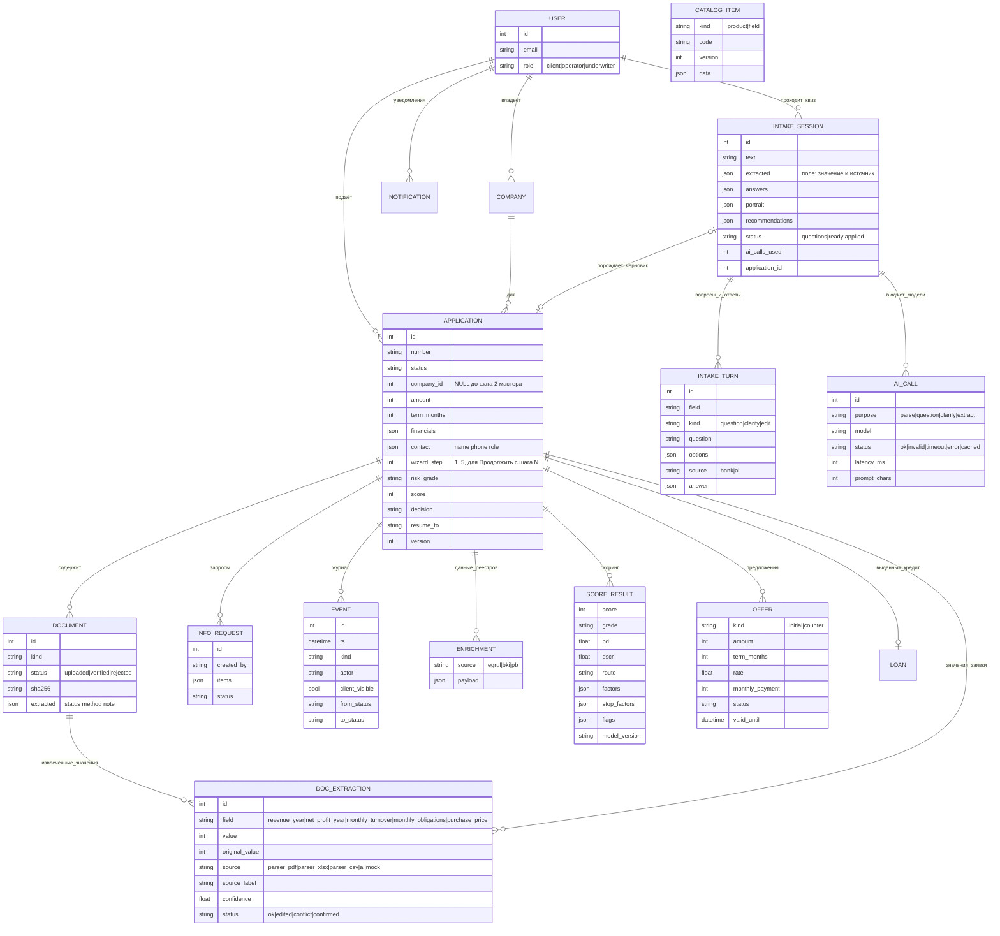

> Актуальное состояние сдаваемой версии: [RELEASE.md](RELEASE.md) и корневой README. Ниже — подробности исходной реализации; старые примеры ставок не являются текущими публичными условиями.

# Модель данных

Принципы:
* **Один журнал `EVENT`** — и таймлайн для клиента (`client_visible`), и аудит для банка. Записи не изменяются.
* **Данные не теряются между этапами:** данные заявки, ответы реестров, каждый расчёт скоринга и каждое предложение хранятся отдельными строками; пересчёт скоринга добавляет запись, а не перезаписывает.
* `APPLICATION.resume_to` помнит, куда вернуть заявку после ответа клиента (полная проверка или обратно специалисту).
* `APPLICATION.version` растёт на каждом переходе статуса; решения проверяют ожидаемый статус, поэтому двойной клик или параллельное решение даёт `409`.
* **Квиз хранится целиком:** `INTAKE_SESSION` помнит исходный текст, что из него поняли правила (`extracted`, источник `text|ai`), ответы карточками (`answers`) и портрет; `INTAKE_TURN` — каждый показанный вопрос, откуда он взят (`bank` или `ai`) и ответ клиента.
* **`AI_CALL` — журнал и бюджет модели:** по числу обращений считается лимит `LLM_MAX_CALLS` на сессию квиза или заявку. Текст запроса не сохраняется — только цель, статус, задержка и размер.
* **`DOC_EXTRACTION` — «значение + подпись источника + статус».** Правка клиента меняет `value`, но `original_value` остаётся; `conflict` ставится правилом «оборот×12 против выручки > 35%», `confirmed` — явным подтверждением клиента.
* **`CATALOG_ITEM`** — копия конфигурации (`backend/app/config_data/*.json`) с версией: видно, по какому каталогу продуктов и реестру полей работал квиз.
* `APPLICATION.wizard_step` — шаг мастера; `company_id` пуст, пока клиент не ввёл ИНН (черновик создаётся сразу после подбора).
* Файлы лежат вне БД под случайными именами; в БД — имя, размер и SHA-256.
