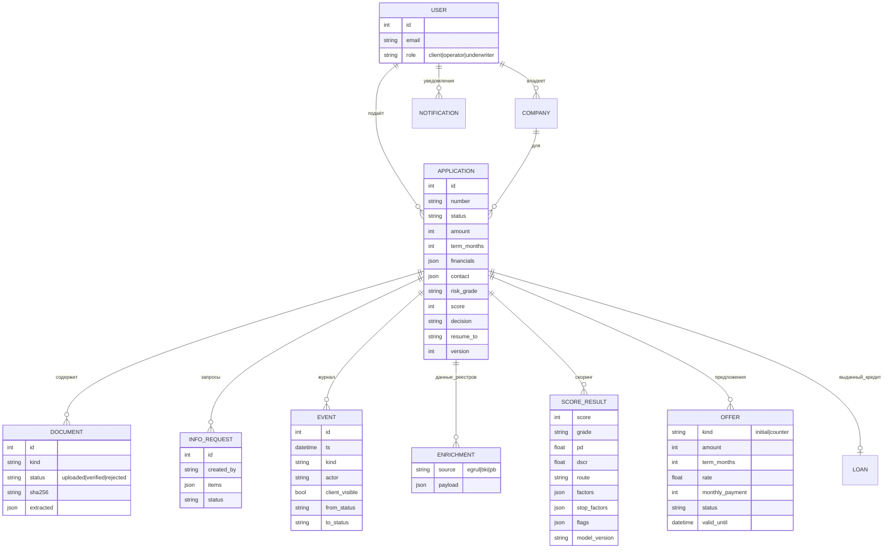

# Модель данных

Принципы:
* **Один журнал `EVENT`** — и таймлайн для клиента (`client_visible`), и аудит для банка. Записи не изменяются.
* **Данные не теряются между этапами:** данные заявки, ответы реестров, каждый расчёт скоринга и каждое предложение хранятся отдельными строками; пересчёт скоринга добавляет запись, а не перезаписывает.
* `APPLICATION.resume_to` помнит, куда вернуть заявку после ответа клиента (полная проверка или обратно специалисту).
* `APPLICATION.version` растёт на каждом переходе статуса; решения проверяют ожидаемый статус, поэтому двойной клик или параллельное решение даёт `409`.
* Файлы лежат вне БД под случайными именами; в БД — имя, размер и SHA-256.
