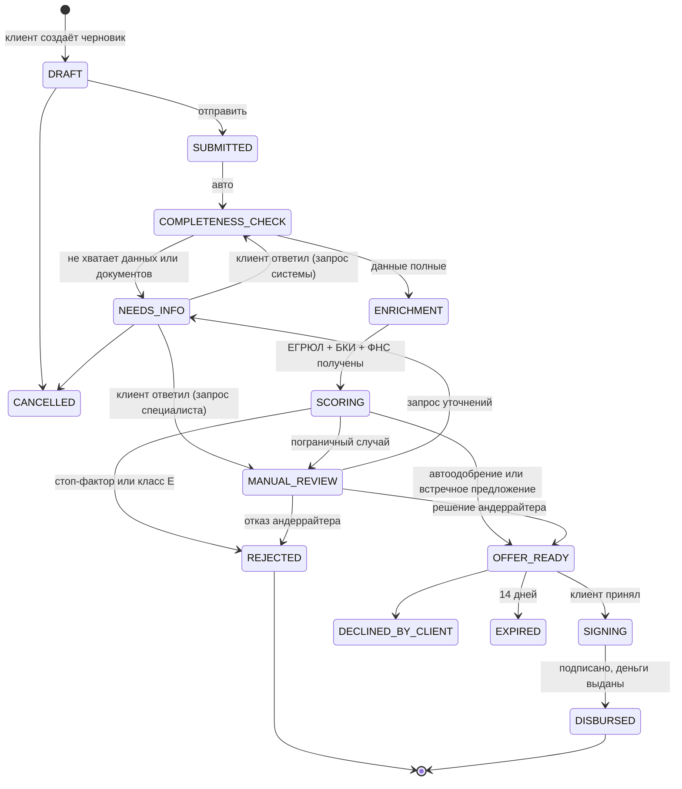
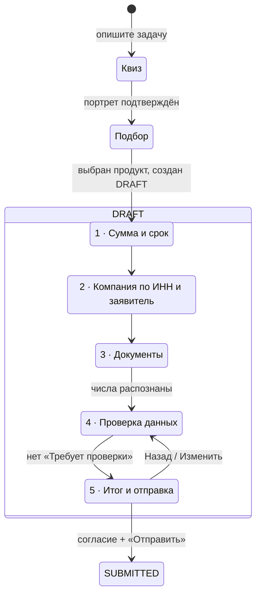

# Диаграмма состояний заявки

Переходы разрешены только в `backend/app/services/workflow.py::TRANSITIONS`; любой другой переход отвечает `409`.

| Статус | Что видит клиент | Кто действует |
|---|---|---|
| DRAFT | Черновик | клиент |
| SUBMITTED, COMPLETENESS_CHECK, ENRICHMENT, SCORING | «Проверяем…» (бегущий прогресс) | система |
| NEEDS_INFO | Форма ответа на запрос | клиент |
| MANUAL_REVIEW | «Рассматривает специалист» | андеррайтер |
| OFFER_READY | Карточка предложения | клиент |
| SIGNING | Договор, подпись | клиент |
| DISBURSED / REJECTED / DECLINED_BY_CLIENT / EXPIRED / CANCELLED | Итог и причина | — |

## Подсостояния черновика (мастер в режиме фокуса)

Статус `DRAFT` не меняется, пока клиент оформляет заявку; прогресс хранится в `APPLICATION.wizard_step` (1–5), поэтому клиент возвращается кнопкой «Продолжить с шага N».

## Что происходит и нужно ли действие клиента

Для каждого статуса API отдаёт `what` (что происходит), `needs_action` и `action_text`; кабинет показывает их в блоке «Что происходит / Нужно ли действие от вас».

| Статус | Что происходит | Действие клиента |
|---|---|---|
| DRAFT | заявка не отправлена, данные сохраняются | да: дойти до конца и отправить |
| SUBMITTED | банк получил заявку | нет |
| COMPLETENESS_CHECK | проверка полноты и согласованности чисел | нет |
| NEEDS_INFO | обработка приостановлена: не хватает данных или есть расхождение | да: ответить на запрос |
| ENRICHMENT | сверка с реестрами и БКИ (симуляторы) | нет |
| SCORING | оценка риска и подбор условий; оценка — не решение | нет |
| MANUAL_REVIEW | заявку смотрит специалист | нет |
| OFFER_READY | банк подготовил условия на ограниченное время | да: принять или отклонить |
| SIGNING | договор готов (в демо без реальной подписи) | да: подтвердить подписание |
| REJECTED / DISBURSED / DECLINED_BY_CLIENT / EXPIRED / CANCELLED | итог, причина указана | нет |
