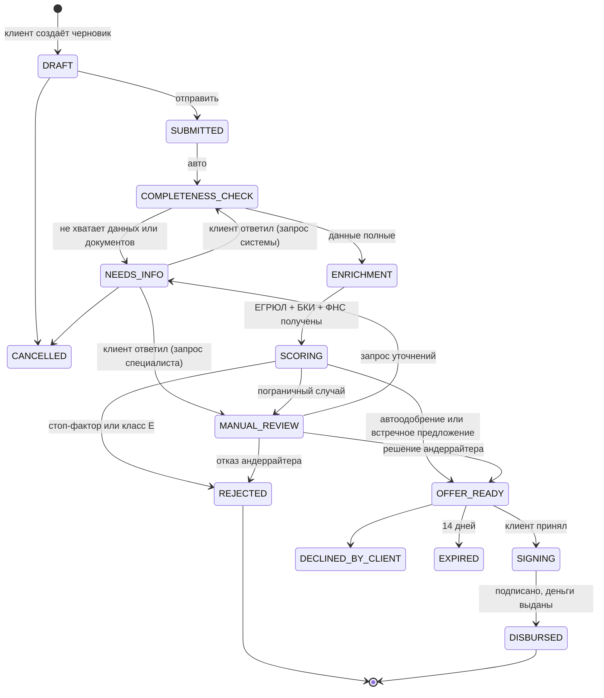

# Диаграмма состояний заявки

Переходы разрешены только в `backend/app/services/workflow.py::TRANSITIONS`; любой другой переход отвечает `409`.

| Статус | Что видит клиент | Кто действует |
|---|---|---|
| DRAFT | Черновик | клиент |
| SUBMITTED, COMPLETENESS_CHECK, ENRICHMENT, SCORING | «Проверяем…» (бегущий прогресс) | система |
| NEEDS_INFO | Форма ответа на запрос | клиент |
| MANUAL_REVIEW | «Рассматривает специалист» | андеррайтер |
| OFFER_READY | Карточка предложения | клиент |
| SIGNING | Договор, подпись | клиент |
| DISBURSED / REJECTED / DECLINED_BY_CLIENT / EXPIRED / CANCELLED | Итог и причина | — |
